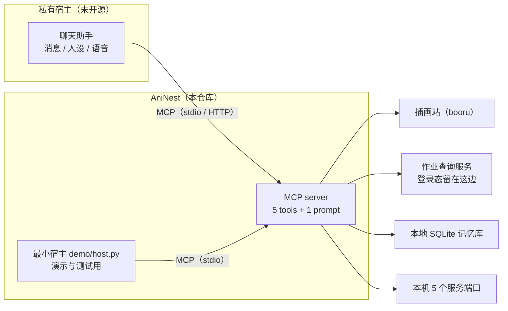

# AniNest · aninest-mcp

[](https://github.com/moriruruka/aninest-mcp/actions/workflows/ci.yml)
[](https://www.python.org/)
[](LICENSE)

> **AniNest**（Ani = Anime/ACG，Nest = 巢）：把一个二次元向 AI 助手的本事装进一个巢——
> 查竞技场作业、按中文描述找插画、读本地记忆、看本地服务是否在线——再用
> **MCP（Model Context Protocol，模型上下文协议）** 交给任何宿主调用。
> 巢是会长大的：加一个新插件，就多一根新的枝条。

它把"只有本机能做"的能力暴露成协议级工具。任何支持 MCP 的宿主——桌面 Agent、编辑器、自研客户端——
都能发现并调用这五个工具，而不用知道背后是哪个图站、哪个本地服务、哪个游戏。

> 它不是又一个"封装 API 的 demo"：包含 tag 编译器、检索降级阶梯、只读 SQLite 检索、本地服务探活，
> 有 65 个单元测试和一套可回归的评测集，CI 在 Linux/Windows × Python 3.10/3.12/3.13 上跑。

---

## 目录

- [它解决什么问题](#它解决什么问题)
- [来历：从私有助手拆出来的能力层](#来历从私有助手拆出来的能力层)
- [架构](#架构)
- [五个工具](#五个工具)
- [快速开始](#快速开始)
- [看得见的验证：一条命令跑完整段对话](#看得见的验证一条命令跑完整段对话)
- [接入客户端](#接入客户端)
- [配置项](#配置项)
- [可靠性与安全设计](#可靠性与安全设计)
- [评测结果](#评测结果)
- [实现对照（能力 → 代码位置）](#实现对照能力--代码位置)
- [开发](#开发)
- [数据边界与隐私](docs/PRIVACY.md)
- [设计取舍](docs/DECISIONS.md)
- [威胁模型：它能动什么、谁能让它动](docs/THREAT_MODEL.md)
- [代码结构与改动指引](docs/ARCHITECTURE.md)

---

## 它解决什么问题

个人助手（这里是一个跑在 Windows 上的 QQ 机器人）积累了很多"只有本机能做"的能力：
查游戏作业、按中文描述找插画、读本地记忆、看服务是否在线。
这些能力原先散落在插件里，只能被那一个机器人调用。

MCP 把它们变成**协议级工具**：

| 之前 | 现在 |
| --- | --- |
| 能力绑定在单个 QQ 机器人里 | 任何 MCP 宿主都能用（桌面 Agent、编辑器、CI 脚本） |
| 参数靠口头约定 | 参数有 JSON Schema，宿主负责校验与补全 |
| 出错只能翻机器人日志 | 工具返回结构化错误，宿主可以决定重试或换路 |
| 无法被评测 | `eval/run_eval.py` 可回归，CI 里跑 |

## 来历：从私有助手拆出来的能力层

这五个工具不是为写示例而写的，它们原本长在一个**私有**的个人助手里（自己电脑上的 QQ 聊天助手），
和消息格式、人设、账号登录态缠在一起。把它们抽成协议级工具之后，能力才第一次能被别的宿主复用、被单独测试、被回归评测。



完整来历、以及“哪些东西刻意没有开源”见 [docs/ORIGIN.md](docs/ORIGIN.md)。

## 架构

```
┌──────────────────────────── MCP 宿主（任意） ────────────────────────────┐
│  Claude Desktop / DSH / 编辑器插件 / scripts/mcp_smoke.py                 │
└───────────────────────────────┬──────────────────────────────────────────┘
                                │  MCP over stdio / Streamable HTTP / SSE
┌───────────────────────────────▼──────────────────────────────────────────┐
│                                aninest-mcp                               │
│  ┌──────────────┐  ┌──────────────┐  ┌───────────────┐  ┌─────────────┐  │
│  │ tagging.py   │  │ tools/art.py │  │ tools/memory  │  │ tools/      │  │
│  │ 中文→tag 编译 │→ │ 检索+降级阶梯 │  │ 只读 SQLite   │  │ arena       │  │
│  └──────────────┘  └──────┬───────┘  └───────┬───────┘  └──────┬──────┘  │
│  ┌──────────────┐         │                  │                 │         │
│  │ tools/health │         │                  │                 │         │
│  └──────────────┘         │                  │                 │         │
└───────────────────────────┼──────────────────┼─────────────────┼─────────┘
                            │ HTTPS            │ read-only       │ HTTP
                   ┌────────▼────────┐  ┌──────▼──────┐  ┌───────▼────────┐
                   │ 图站 JSON API    │  │ memory.db   │  │ 本机浏览器服务  │
                   │ (Gelbooru 风格)  │  │ (WAL)       │  │ (持登录态)      │
                   └─────────────────┘  └─────────────┘  └────────────────┘
```

## 五个工具

| 工具 | 作用 | 关键参数 | 返回 |
| --- | --- | --- | --- |
| `art_search` | 中文/英文描述 → 图站检索 → 图片链接 | `query`、`count`、`size`、`orientation`、`extra_tags`、`negative` | `tags`、`tags_used`、`relaxed`、`results[]`（含 `image_url` / 尺寸 / 分级） |
| `arena_lookup` | 阵容 → 防守作业摘要 | `def_ids`（1–5 个六位角色 id，一队 5 人）、`region`、`limit` | `found`、`teams[]` |
| `memory_search` | 本地记忆检索（只读） | `query`、`limit`、`scope` | `matched`、`hits[]`（含 `score`） |
| `memory_stats` | 记忆库规模与分布 | — | 行数、`by_scope`、`by_status`、`db_bytes` |
| `service_health` | 本机服务存活探测 | — | 每个端口的 `up` 与汇总 |

示例（`art_search`）：

```json
{
  "query": "初音未来 泳装 竖图 1张 压缩图",
  "tags": ["hatsune_miku", "swimsuit"],
  "tags_used": "hatsune_miku swimsuit",
  "size": "compressed",
  "orientation": "portrait",
  "relaxed": false,
  "attempt": 1,
  "count": 1,
  "results": [
    {
      "id": 4851292,
      "page_url": "https://safebooru.org/index.php?page=post&s=view&id=4851292",
      "image_url": "https://safebooru.org/images/4851/8b1c....jpeg",
      "width": 1200, "height": 1800, "rating": "safe",
      "tags": "1girl hatsune_miku swimsuit ..."
    }
  ]
}
```

## 快速开始

```bash
git clone https://github.com/moriruruka/aninest-mcp.git
cd aninest-mcp

python -m venv .venv
# Windows: .venv\Scripts\activate    macOS/Linux: source .venv/bin/activate
pip install -e ".[dev]"

python -m unittest discover -s tests -v   # 65 tests
python eval/run_eval.py                   # 离线评测，26/26

# stdio 模式（给桌面客户端用）
aninest-mcp

# 或 Streamable HTTP 模式
ANINEST_MCP_TRANSPORT=streamable-http ANINEST_MCP_PORT=8765 aninest-mcp
```

Docker：

```bash
docker build -t aninest-mcp .
docker run --rm -p 127.0.0.1:8765:8765 aninest-mcp
# 或者
docker compose up --build
```

拉不到 `python:3.12-slim` 时（国内网络 / 私有 registry），换一个可达的 mirror 当基础镜像即可，
构建步骤完全一致：

```bash
docker build --build-arg PYTHON_IMAGE=docker.m.daocloud.io/library/python:3.12-slim -t aninest-mcp .
```

镜像行为已实测（Docker 29.9.2，Linux 容器）：以 `uid=10001` 非 root 运行、`HEALTHCHECK`
转 healthy、`initialize` 握手返回 `serverInfo.version = 0.1.0`、`tools/list` 返回全部 5 个工具。

## 看得见的验证：一条命令跑完整段对话

不需要账号、不需要网络、不需要客户端：

```bash
python demo/story.py
```

它会在本机起一个假的作业服务、造一个示例记忆库，然后用**最小宿主**通过真实 MCP stdio 协议连上 server，
把三句话依次变成工具调用，再把返回的结构化结果说成人话。实跑输出：

```text
[story] 准备：示例记忆库 + 假作业服务
[story] 连上 server，开始对话

[host] 已连接 5 个工具：art_search、arena_lookup、memory_search、memory_stats、service_health

你   > 本机服务都活着吗
host > 调 service_health({})
mcp  > { "host": "127.0.0.1", "up": 5, "total": 5, "services": { ... } }
host > 5/5 个服务在线。

你   > 帮我回忆一下泳装插画那件事
host > 调 memory_search({"query": "泳装插画那件事", "limit": 5})
mcp  > { "scanned": 5, "matched": 1, "hits": [{ "content": "用户偏好竖构图的人物插画，尤其是海边的场景。" }] }
host > 想起 1 条，最相关的是：「用户偏好竖构图的人物插画，尤其是海边的场景。」

你   > 查一下 100141 100241 100341 100441 100541 的作业
host > 调 arena_lookup({"def_ids": [100141, 100241, 100341, 100441, 100541], "limit": 3})
mcp  > { "found": 2, "teams": [{ "defense": [100201, 110501, 102301, 100101, 114701], "upvotes": 1 }] }
host > 找到 2 支队伍，最热门的是：100201 / 110501 / 102301 / 100101 / 114701（赞 1、踩 0）。
```

`demo/host.py` 只做两件事：**把一句话映射成工具名 + 参数**（`route()`），**把返回的 JSON 说成人话**（`_speak()`）。
换成真模型做这两步，就是任何 MCP 客户端的日常。`tests/test_demo_router.py` 覆盖了这套路由（8 个用例）。

> `art_search` 在 demo 里没有演，因为它要真联网抓图；联网行为由 `python eval/run_eval.py --network` 覆盖。

### 对着你自己的服务再验一遍

demo 用的是替身，真正能说明“它在你机器上活着”的是这个脚本——它连你自己正在跑的五个服务，
逐个调一遍，打印一行结果，全过才返回 0：

```bash
python scripts/live_check.py            # 默认 5 项全查
python scripts/live_check.py --skip-network   # 没网时跳过 art_search
```

在本机实测（AstrBot 全景在跑、记忆库 36 条）：

```text
[ ok ] service_health  5/5 up
[ ok ] memory_stats    rows=36 global=5 session=31
[ ok ] memory_search   scanned=36 matched=2
[ ok ] arena_lookup    found=10 defense=[100201, 110501, 102301, 100101, 114701] up=1
[ ok ] art_search      1 image(s), 665x957 rating=safe

all checks passed
```

## 接入客户端

**Claude Desktop**（`claude_desktop_config.json`）：

```json
{
  "mcpServers": {
    "aninest": {
      "command": "aninest-mcp",
      "env": {
        "ANINEST_BOORU_URL": "https://safebooru.org/index.php",
        "ANINEST_MEMORY_DB": "C:/Users/you/.aninest/memory.db"
      }
    }
  }
}
```

**DSH / 其他支持 MCP 的宿主**：把 `aninest` 作为 stdio 服务器加入其 MCP 配置（命令 `aninest-mcp`，或用
`python -m aninest`），也可用 `ANINEST_MCP_TRANSPORT=streamable-http` 后按 URL `http://127.0.0.1:8765/mcp` 接入。

**自检脚本**（不需要任何客户端）：

```bash
python scripts/mcp_smoke.py                  # 列出工具 + 调 service_health
python scripts/mcp_smoke.py --call art_search --args '{"query":"初音未来 泳装","count":1}'
```

## 配置项

全部通过环境变量注入，仓库里没有任何凭证文件（见 [.env.example](.env.example)）。

| 变量 | 默认值 | 说明 |
| --- | --- | --- |
| `ANINEST_MCP_TRANSPORT` | `stdio` | `stdio` / `streamable-http` / `sse` |
| `ANINEST_MCP_HOST` / `ANINEST_MCP_PORT` | `127.0.0.1` / `8765` | 仅 HTTP/SSE 模式生效 |
| `ANINEST_BOORU_URL` | `https://safebooru.org/index.php` | 任何 Gelbooru 风格 JSON API |
| `ANINEST_HTTP_TIMEOUT` | `15` | 秒 |
| `ANINEST_USER_AGENT` | `aninest-mcp/0.1 (+…)` | 图站要求可识别的 UA |
| `ANINEST_ARENA_URL` | `http://127.0.0.1:6191` | 本机浏览器服务（持登录态） |
| `ANINEST_MEMORY_DB` | `~/.aninest/memory.db` | 只读打开 |
| `ANINEST_PROBE_HOST` | `127.0.0.1` | 健康探测目标 |

## 可靠性与安全设计

- **tag 编译可回归**：规则表 + 最长优先替换，26 条 golden case 全离线跑，`recall=1.0 / precision=1.0`。
- **检索降级阶梯**：`全条件 → 去方向约束 → 逐个减 tag`，最多 3–4 次请求；返回里带 `relaxed`/`attempt`，不偷偷骗人。
- **分级归一化**：`s/safe/g/general` 都当 safe，`q/e` 一律丢弃——只放行确定安全的图。
- **宁可报错也不编造**：网络错误、非 JSON 响应、空结果分别抛 `ToolError`，不返回假数据。
- **只读记忆库**：`file:...?mode=ro` 打开，物理上不可能写坏主程序的数据。
- **零凭证**：竞技场查询走本机浏览器服务，凭证留在浏览器 profile，不进代码、不进仓库。
- **可审计**：每个工具返回结构化字段（`relaxed`、`attempt`、`score`、`rating`），日志里不需要猜。

## 本机依赖与第三方复现

五个工具里，只有 `arena_lookup` 依赖一个**不属于本仓库**的本机服务（持登录态的浏览器进程，
它的凭证属于一次具体部署，不会开源）。为了让任何人都能自己验证，仓库带了两个替身脚本：

| 工具 | 依赖 | 没有依赖时怎么验证 |
| --- | --- | --- |
| `art_search` | 公网图站（默认 safebooru） | 直接可用 |
| `memory_search` / `memory_stats` | 一个 SQLite 文件 | `python scripts/make_demo_db.py --out demo_memory.db` |
| `arena_lookup` | 本机服务的 `POST /search` | `python scripts/fake_arena.py --port 6192`（同契约假数据） |
| `service_health` | 无 | 五个端口全 down 也是合法结果 |

两分钟复现（不需要任何客户端、也不需要作者本机环境）：

```bash
# 1) 记忆工具：造一个示例库再查
python scripts/make_demo_db.py --out demo_memory.db
ANINEST_MEMORY_DB=./demo_memory.db python scripts/mcp_smoke.py --call memory_stats

# 2) 作业查询：起假服务，再走真实 MCP stdio 调用
python scripts/fake_arena.py --port 6192 &
ANINEST_ARENA_URL=http://127.0.0.1:6192 python scripts/mcp_smoke.py --call arena_lookup \
  --args '{"def_ids":[100141,100241,100341,100441,100541]}'
```

## 评测结果

环境：Windows 11，Python 3.13，本机直连（无代理），2026-10-29。

| 指标 | 结果 |
| --- | --- |
| 单元测试 | **55 passed**（tagging / shape / arena / memory / health） |
| 离线评测（tag 编译，26 条 golden case） | **26/26**，tag recall **1.000**，precision **1.000**，字段准确率 **1.000** |
| 联网端到端（18 条真实请求） | **18/18 成功**，p50 **1.67 s**，p95 **1.99 s** |

复现：

```bash
python eval/run_eval.py --network --online-cases 18 --json eval/report.json
```

> 说明：联网成功率依赖图站可达性；离线部分确定可复现，CI 只跑离线。

## 实现对照（能力 → 代码位置）

写这一节是为了让读者能在 30 秒内定位到对应实现，而不是只看关键词。

| 能力 / 关键词 | 在本仓库的落点 |
| --- | --- |
| Python 工程化 / 包管理 | `pyproject.toml`（hatchling、可选依赖、console script）、`src/` 布局、`pip install -e ".[dev]"` |
| 代码质量门禁 | `ruff`（E/F/I/UP/B）、`unittest`、CI 矩阵（ubuntu-24.04 / windows-2025 × 3.10/3.12/3.13） |
| MCP / 工具调用（Tool Use） | `src/aninest/server.py`（FastMCP 注册 5 个工具 + resource + prompt） |
| JSON Schema / 参数校验 | 工具签名 + 类型注解自动生成 schema；`validate_ids`、`normalise_rating` 做业务校验 |
| 异步编程 | `httpx.AsyncClient`、`async def` 工具、`asyncio.run` 评测入口 |
| 错误处理与可观测 | 统一 `ToolError`；返回结构化字段 `relaxed`/`attempt`/`score` |
| 检索 / RAG 基础 | `tools/memory.py` 的 token 重叠 + 重要性先验打分；`docs/DECISIONS.md` 说明为何不上向量库 |
| 数据持久化 / SQLite | `tools/memory.py` 只读 URI 连接、WAL 友好、`_connect` 超时 |
| HTTP 客户端与限流友好 | 单请求超时、UA 可配置、降级阶梯限制请求次数 |
| 容器化 | `Dockerfile`（非 root、HEALTHCHECK）、`docker-compose.yml`、`.dockerignore` |
| CI/CD | `.github/workflows/ci.yml`（lint → test → offline eval → docker build + smoke） |
| 测试设计 | `tests/` 5 个模块 55 例，纯函数优先；`tests/context.py` 让测试无需安装即可跑 |
| 文档 | `README.md`、`docs/DECISIONS.md`（ADR）、`docs/ARCHITECTURE.md`（结构与改动指引）、`docs/PRIVACY.md`（数据边界）、`docs/THREAT_MODEL.md`、`CHANGELOG.md` |
| 安全意识 | 只放行 safe 分级、零凭证、只读数据库、`docs/PRIVACY.md` 的 5 条 grep 自查 |

## 开发

```bash
ruff check src tests eval     # lint
python -m unittest discover -s tests -v
python eval/run_eval.py       # 离线评测
```

> 依赖锁定说明：`mcp` 2.x 把 `FastMCP` 改名为 `MCPServer` 并调整了工具注册 API，本项目锁定
> `mcp>=1.20,<2`。升级到 2.x 需要把 `server.py` 的注册方式与 `ToolError` 导入一起迁移。

目录结构：

```
src/aninest/
  config.py          # 环境变量 → Settings（含 5 个本地服务端口）
  tagging.py         # 中文 → booru tag 编译器（纯函数，可单测）
  server.py          # FastMCP 注册：5 tools + 1 resource + 1 prompt
  tools/
    art.py           # 检索 + 降级阶梯 + 分级归一化
    arena.py         # 阵容校验 + 上游 payload 扁平化
    memory.py        # 只读 SQLite 检索与统计
    health.py        # TCP 探活
tests/               # 65 个 unittest
eval/                # golden set + 离线/联网评测脚本
scripts/             # 不依赖客户端的自检脚本
docs/                # ADR、隐私自查
```

## Roadmap

- [ ] 图站适配层：把 konachan / yande.re（Moebooru）加入 `ANINEST_BOORU_URL` 的等价实现
- [ ] `art_search` 返回缩略图 base64（省一次客户端下载）
- [ ] 记忆检索升级为 embedding（保留现有打分作为降级路径）
- [ ] `arena_lookup` 增加"按角色名查询 id"的辅助工具
- [ ] HTTP 模式加 Bearer 鉴权（当前仅监听 127.0.0.1）

## License

[MIT](LICENSE)
