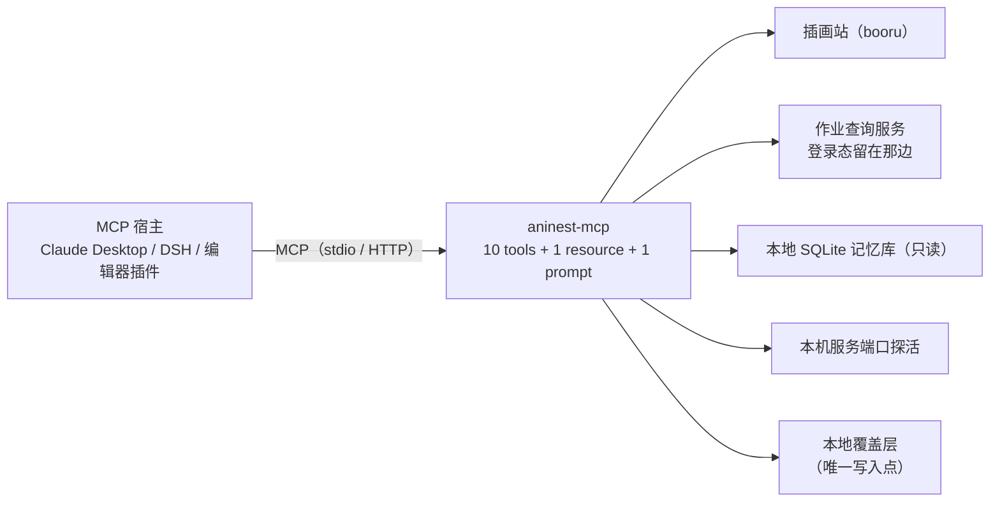

# AniNest · aninest-mcp

[](https://github.com/moriruruka/aninest-mcp/actions/workflows/ci.yml)
[](https://www.python.org/)
[](LICENSE)

一个基于 **MCP（Model Context Protocol，模型上下文协议）** 的只读能力服务器，提供十个工具：
按中文描述找插画、按角色名查竞技场作业、用头像认角色、检索本地记忆、探活本机服务。

任何支持 MCP 的宿主（Claude Desktop、Cursor、自研 Agent、CI 脚本）都可以直接调用，
不需要知道背后是哪个图站、哪个本地服务、哪个游戏。

- 传输：`stdio`（桌面客户端）与 `streamable-http`（远端调用）
- 协议：`2025-11-25`，十个工具全部带 `title` 与 `annotations`
- 依赖：Python 3.10+，`mcp` 1.x，`httpx`；识图额外需要 `pillow` + `numpy`

## 快速开始

**Windows，不想碰命令行**：下载 ZIP 解压 → 双击 `install.cmd`。脚本会建独立环境、装依赖、
自检一次握手，并打印可直接粘贴的客户端配置。

```powershell
# 等价用法（加 -WriteClaudeConfig 会顺手写好 Claude Desktop 配置）
.\install.ps1 -Mirror https://pypi.tuna.tsinghua.edu.cn/simple
```

**任何系统，用命令行**：

```bash
pip install "git+https://github.com/moriruruka/aninest-mcp.git"
aninest-mcp                      # stdio 模式，等宿主连接
```

**容器**：

```bash
docker build -t aninest-mcp .
docker run --rm -p 127.0.0.1:8765:8765 -e ANINEST_MCP_TRANSPORT=streamable-http aninest-mcp
```

> 本仓库不发布到 PyPI，`pip install aninest-mcp` 会 404；装法就是上面这几条。
> 装不上的排查、镜像加速、卸载、干净环境验证：**[安装说明](docs/INSTALL.md)**。

## 工具

| 工具 | 典型请求 | 返回 |
| --- | --- | --- |
| `art_search` | "来两张初音未来泳装的竖图" | 图片链接 + 用到的 tag + 是否放宽过条件 |
| `arena_lookup` | "布丁、克总、真琴、纺希、莉莎这队作业" | 别人用的防守阵容（含角色名）与票数 |
| `character_lookup` | "布丁和克总分别是哪个角色" | 角色名、六位 id、四位数 uid、别名 |
| `portrait_identify` | "这几张头像分别是谁" | 每张头像的候选角色与相似度 |
| `memory_search` | "上次说的那个配色偏好还记得吗" | 记忆条目 + 打分 + 范围（本会话/全局） |
| `memory_stats` | "记忆存了多少了" | 行数、范围分布、库大小 |
| `service_health` | "服务都活着吗" | 五个本地端口的连通性 |
| `character_match` | "宫紫 是哪个角色"（表里没有） | 按名字相似度排的候选、分数、命中方式 |
| `character_update` | "日服刚出的新角色，加一下" | 写本地覆盖层，返回角色与别名变更 |
| `character_correct` | "宫紫 就是宫子，记住" | 把这个词记成别名，留一条带时间的更正记录 |

阵容可以直接说人话：**角色名、黑话、四位数 uid、六位 id 混着写都行**（`布丁 克总 100301`），一队 5 人。
查不到作业时，同一次调用就能带上"排除某角色"或"把 A 换成 B"再查：

```json
{ "defense": ["布丁", "克总", "真琴"], "exclude": ["真琴"] }
{ "defense": ["布丁", "克总", "真琴"], "replace": ["布丁->怜"], "region": 1 }
```

### 读与写

前七个工具**只读**：不写调用方的数据、不发消息、不动账号。
`character_update` / `character_correct` 只写本地覆盖层（默认 `~/.aninest/pcr_overlay.json`，
可用 `ANINEST_PCR_OVERLAY` 改路径），不碰随包分发的角色表、记忆库和网络。
两者在 `annotations` 里标了 `readOnlyHint=false`、`destructiveHint=false`，
宿主可以据此只对它们要求用户确认。

参数细节、返回字段、报错含义：**[使用说明](docs/USAGE.md)**。

### 保持角色表是新的

新角色通常先在日服上线，中文译名要过一阵才有人用。拿到日文名就先
`character_update(jp="ミヤコ")` 登记，`character_lookup` / `character_match` 马上能按日文名查到。
匹配错了不用新建角色：先 `character_match` 看候选和分数，让用户挑，再
`character_correct(term, char_id)` 把这个叫法记下来。两处改动都只写覆盖层，
包内 `src/aninest/data/pcr_chars.json` 不动，升级也不会被覆盖。

## 演示

**一段对话，不需要任何客户端**：

```bash
python demo/story.py
```

它自己起一个示例记忆库和假作业服务，连上 server，输出一轮完整对话：

```text
你   > 布丁、克总、真琴、纺希、莉莎这个防守，把布丁换成怜，再查一次
host > 按 1号位 怜 / 2号位 克莉丝提娜 / 3号位 真琴 / 4号位 纺希 / 5号位 莉莎 查（把 宫子 换成 怜）：
       找到 2 支队伍，最热门的是 优衣 / 香织(夏日) / 绫音 / 日和 / 矛依未(新年)（赞 1、踩 0）。
```

`demo/host.py` 是最小宿主：一句话 → 选工具 → 把 JSON 说成人话。它故意不用大模型，
用确定性关键词路由，所以不需要 API key 就能复现。换成真模型做这两步，就是任何 MCP 客户端的日常。

**一张截图 → 一套阵容（宿主侧胶水示例）**：

```bash
python demo/screenshot_lineup.py shot.png --grid 5x3 --rows 1
```

流程是 `截图 → 按格子裁出头像 → portrait_identify → arena_lookup`。
裁图这一步**故意留在宿主侧**：每个宿主的截图尺寸、UI 版本、可见行数都不一样，
而 server 只回答"这张裁好的头像图是谁"。号位从右往左数（1 号位是最右边的前卫），
默认 `--order rtl`，也可以用 `--boxes "x,y,w,h;..."` 钉死矩形。

## 接入客户端

**Claude Desktop**（`claude_desktop_config.json`）：

```json
{
  "mcpServers": {
    "aninest": {
      "command": "aninest-mcp",
      "env": {
        "ANINEST_BOORU_URL": "https://safebooru.org/index.php",
        "ANINEST_MEMORY_DB": "C:/Users/you/.aninest/memory.db"
      }
    }
  }
}
```

**通用 stdio 客户端**：命令 `aninest-mcp`（或 `python -m aninest`），传输 `stdio`，没有必填参数。

**HTTP 客户端**（远端或容器）：

```bash
ANINEST_MCP_TRANSPORT=streamable-http ANINEST_MCP_PORT=8765 aninest-mcp
# 然后连 http://127.0.0.1:8765/mcp
```

**DSH（DeepSeek Harness）**：把下面这段加进 profile 的 `cordis.patch.yml`，重启后工具以
`mcp__aninest__art_search` 这样的名字出现：

```yaml
- id: mcp-aninest
  name: '@deepseek-ai/dsh-mcp-client'
  config:
    serverName: aninest            # 工具前缀，命名空间内唯一
    transport: stdio
    command: python
    args: ['-m', 'aninest']
    env:
      ANINEST_MEMORY_DB: 'C:/Users/you/.aninest/memory.db'
```

**自检脚本**（不需要任何客户端）：

```bash
python scripts/mcp_smoke.py                  # 列工具 + 调 service_health
python scripts/mcp_smoke.py --call art_search --args '{"query":"初音未来 泳装","count":1}'
```

## 配置

全部通过环境变量注入，仓库里没有任何凭证文件（见 [.env.example](.env.example)）。

| 变量 | 默认值 | 说明 |
| --- | --- | --- |
| `ANINEST_MCP_TRANSPORT` | `stdio` | `stdio` / `streamable-http` / `sse` |
| `ANINEST_MCP_HOST` / `ANINEST_MCP_PORT` | `127.0.0.1` / `8765` | 仅 HTTP/SSE 模式生效 |
| `ANINEST_BOORU_URL` | `https://safebooru.org/index.php` | 任何 Gelbooru 风格 JSON API |
| `ANINEST_HTTP_TIMEOUT` | `15` | 秒 |
| `ANINEST_USER_AGENT` | `aninest-mcp/0.4.1 (+…)` | 图站要求可识别的 UA |
| `ANINEST_ARENA_URL` | `http://127.0.0.1:6191` | 作业查询服务（见下文"本机依赖"） |
| `ANINEST_MEMORY_DB` | `~/.aninest/memory.db` | 只读打开 |
| `ANINEST_PROBE_HOST` | `127.0.0.1` | 健康探测目标 |
| `ANINEST_PCR_AVATARS` | （空） | 头像目录 `<六位 id>.webp`；不配则 `portrait_identify` 明确报错 |
| `ANINEST_PCR_OVERLAY` | `~/.aninest/pcr_overlay.json` | 两个写工具落盘的位置 |

## 本机依赖与替身

十个工具里，只有 `arena_lookup` 依赖一个**不在本仓库内**的本机服务（持登录态的浏览器进程），
其余工具都能独立验证。没有那个服务时，用仓库自带的替身跑同一套契约：

| 工具 | 依赖 | 没有依赖时怎么验证 |
| --- | --- | --- |
| `art_search` | 公网图站（默认 safebooru） | 直接可用；离线评测覆盖 tag 编译 |
| `character_lookup` / `character_match` | 无（角色表随包分发） | 直接可用 |
| `character_update` / `character_correct` | 无（只写覆盖层） | 直接可用；把 `ANINEST_PCR_OVERLAY` 指到临时文件 |
| `portrait_identify` | 头像包 + `pip install -e ".[vision]"` | `scripts/make_demo_avatars.py --out demo_avatars` |
| `memory_search` / `memory_stats` | 一个 SQLite 文件 | `python scripts/make_demo_db.py --out demo_memory.db` |
| `arena_lookup` | `POST /search` 服务 | `python scripts/fake_arena.py --port 6192`（同契约假数据） |
| `service_health` | 无 | 五个端口全 down 也是合法结果 |

两分钟复现：

```bash
# 1) 记忆工具：造一个示例库再查
python scripts/make_demo_db.py --out demo_memory.db
ANINEST_MEMORY_DB=./demo_memory.db python scripts/mcp_smoke.py --call memory_stats

# 2) 作业查询：起假服务，再走真实 MCP stdio 调用
python scripts/fake_arena.py --port 6192 &
ANINEST_ARENA_URL=http://127.0.0.1:6192 python scripts/mcp_smoke.py --call arena_lookup \
  --args '{"defense":["布丁","克总","真琴"],"limit":2}'

# 3) 识图：造几张合成头像，指着它跑
python scripts/make_demo_avatars.py --out demo_avatars
ANINEST_PCR_AVATARS=./demo_avatars python scripts/mcp_smoke.py --call portrait_identify \
  --args '{"images":["demo_avatars/100101.png"]}'
```

## 测试

```bash
pip install -e ".[dev]"
ruff check src tests eval scripts demo     # 风格与静态检查
python -m unittest discover -s tests       # 单元 + 契约测试
python eval/run_eval.py                    # 离线评测（tag 编译，26 条 golden case）
python eval/run_eval.py --network          # 联网端到端（成功率 / p50 / p95）
python scripts/live_check.py               # 对着正在跑的本地服务逐个调工具
```

当前结果（Windows 11 / Python 3.13 / 本机直连，2026-10-29）：

| 指标 | 结果 |
| --- | --- |
| 单元 + 契约测试 | **172 passed** |
| 离线评测（26 条 golden case） | **26/26**，tag recall **1.000**，precision **1.000**，字段准确率 **1.000** |
| 联网端到端（18 条真实请求） | **18/18 成功**，p50 **1.67 s**，p95 **1.99 s** |
| CI 矩阵 | 3.10 / 3.12 / 3.13 × Ubuntu / Windows + Docker 镜像构建，7 job 全绿 |

每一层能证明什么、不能证明什么，见 **[测试说明](docs/TESTING.md)**。

## 架构



代码结构、模块职责、改哪里看什么：**[架构说明](docs/ARCHITECTURE.md)**。
设计取舍（为什么这样分层、为什么不上向量库等）：**[DECISIONS](docs/DECISIONS.md)**。

## 安全与隐私

- **只读优先**：十个工具里七个只读；写入只落本地覆盖层，原子写、可随时删。
- **零凭证**：`arena_lookup` 走本机服务，登录态存在浏览器 profile 里，不进代码、不进仓库。
- **只放行确定安全的图**：分级归一化（`s/safe/g/general` → safe，`q/e` 丢弃）。
- **不编造**：网络错误、非 JSON 响应、空结果分别报错，不返回假数据。
- **可审计**：返回里带 `relaxed` / `attempt` / `score` / `rating` 等结构化字段。

数据边界见 **[PRIVACY](docs/PRIVACY.md)**，攻击面与信任边界见 **[THREAT_MODEL](docs/THREAT_MODEL.md)**，
与 MCP 规范的对照见 **[COMPLIANCE](docs/COMPLIANCE.md)**。

## 文档

| 内容 | 文件 |
| --- | --- |
| 安装、卸载、故障排查 | [docs/INSTALL.md](docs/INSTALL.md) |
| 工具参数、返回、报错 | [docs/USAGE.md](docs/USAGE.md) |
| 代码结构与改动指引 | [docs/ARCHITECTURE.md](docs/ARCHITECTURE.md) |
| 五层验证与"能证明什么" | [docs/TESTING.md](docs/TESTING.md) |
| 数据边界与隐私 | [docs/PRIVACY.md](docs/PRIVACY.md) |
| 威胁模型 | [docs/THREAT_MODEL.md](docs/THREAT_MODEL.md) |
| MCP 规范符合度 | [docs/COMPLIANCE.md](docs/COMPLIANCE.md) |
| 设计取舍（ADR） | [docs/DECISIONS.md](docs/DECISIONS.md) |
| 变更记录 | [CHANGELOG.md](CHANGELOG.md) |

## 常见问题

**装完客户端看不到工具？** 先跑 `python scripts/mcp_smoke.py`；能看到工具就说明 server 正常，
问题在客户端配置路径或 `command` 写错。

**`portrait_identify` 报"没有头像包"？** 它需要 `ANINEST_PCR_AVATARS` 指向一个目录，
里面是 `<六位 id>.webp|png|jpg`。没有素材时用 `scripts/make_demo_avatars.py` 造几张练手。

**`arena_lookup` 报连不上？** 它只对接本机服务；没有的话用 `scripts/fake_arena.py` 起替身，
或把 `ANINEST_ARENA_URL` 指到任何实现 `POST /search` 的服务。

**装到 3.10 上崩了？** CI 覆盖 3.10/3.12/3.13，遇到问题请附 `python -V` 与完整 traceback。

## Roadmap

- [x] 按角色名 / 黑话 / uid 查阵容
- [x] 裁好的头像 → 角色
- [x] 角色表本地覆盖层（新角色、纠错别名）
- [ ] 整页截图的一体化入口（需要宿主侧的版面适配）
- [ ] 检索层可插拔（当前是确定性关键词，可选接入向量检索）

## License

[MIT](LICENSE)。
