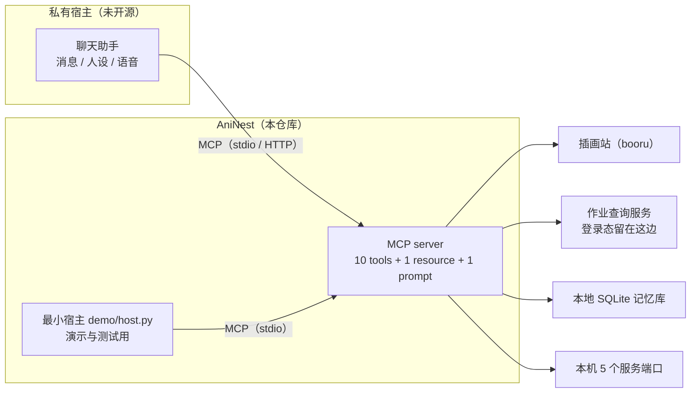

# AniNest · aninest-mcp

[](https://github.com/moriruruka/aninest-mcp/actions/workflows/ci.yml)
[](https://www.python.org/)
[](LICENSE)

把一个二次元向 AI 助手的本事，装进一个能被任何宿主调用的巢。

按名字查竞技场作业 · 按中文描述找插画 · 用名字或头像认角色 · 检索本地记忆 · 探活本机服务 ——
五个领域、十个工具，走
**MCP（Model Context Protocol，模型上下文协议）**。宿主可以是桌面 Agent、编辑器插件、自研客户端，
它们不需要知道背后是哪个图站、哪个本地服务、哪个游戏。

## 30 秒上手

**Windows，不想碰命令行**：下载 ZIP 解压 → 双击 `install.cmd`。脚本会建独立环境、装依赖、
自测一次握手，并把可直接粘贴的客户端配置打印出来。

```powershell
# 也可以自己在 PowerShell 里跑（加 -WriteClaudeConfig 会顺手写好 Claude Desktop 配置）
.\install.ps1 -Mirror https://pypi.tuna.tsinghua.edu.cn/simple
```

**任何系统，习惯命令行**：

```bash
pip install "git+https://github.com/moriruruka/aninest-mcp.git"
```

**容器**：

```bash
docker build -t aninest-mcp . && docker run --rm -p 127.0.0.1:8765:8765 aninest-mcp
```

装完做一件事：告诉客户端去启动 `aninest-mcp`（或 `python -m aninest`）。
完整步骤、镜像加速、卸载、装不上的排查表都在 **[安装说明](docs/INSTALL.md)**。

> 本仓库没有发布到 PyPI，`pip install aninest-mcp` 会 404；上面这条 git URL 才是官方装法。

## 十个工具

| 工具 | 你大概会这么问 | 返回 |
| --- | --- | --- |
| `art_search` | "来两张初音未来泳装的竖图" | 图片链接 + 用到的 tag + 是否放宽过条件 |
| `arena_lookup` | "布丁、克总、真琴、纺希、莉莎这队作业" | 别人用的防守/进攻阵容（含角色名）与票数 |
| `character_lookup` | "布丁和克总分别是哪个角色" | 角色名、六位 id、四位数 uid、别名 |
| `portrait_identify` | "这几张头像分别是谁" | 每张头像的候选角色与相似度 |
| `memory_search` | "上次说的那个配色偏好还记得吗" | 记忆条目 + 打分 + 范围（本会话/全局） |
| `memory_stats` | "你的记忆存了多少了" | 行数、范围分布、库大小 |
| `service_health` | "服务都活着吗" | 五个本地端口的连通性 |
| `character_match` | "宫紫 是哪个角色"（表里没有） | 按名字相似度排的候选、分数（0–1）、命中方式 |
| `character_update` | "日服刚出的新角色，加一下" | 写本地覆盖层，返回角色与新增/移除的别名 |
| `character_correct` | "宫紫 就是宫子，记住" | 把这个词记成别名，并留一条带时间的更正记录 |

阵容可以直接说人话：**角色名、黑话、四位数 uid、六位 id 混着写都行**（`布丁 克总 100301`），
一队 5 人；查不到作业时，同一次调用就能带上"排除某角色"或"把 A 换成 B"再查：

```json
{ "defense": ["布丁", "克总", "真琴"], "exclude": ["真琴"] }
{ "defense": ["布丁", "克总", "真琴"], "replace": ["布丁->怜"], "region": 1 }
```

怎么问、参数怎么填、返回字段什么意思、常见报错怎么办：**[使用说明](docs/USAGE.md)**。
前七个工具**只读**：不写你的数据、不发消息、不动账号。`character_update` 与 `character_correct`
只写本地覆盖层 `~/.aninest/pcr_overlay.json`（`ANINEST_PCR_OVERLAY` 可改路径），
不碰随包分发的角色表、记忆库和网络；`character_match` 仍然只读。

### 保持角色表是新的（Keeping the character table current）

新角色一般先在日服上线，中文译名和黑话要过一阵才有人用。拿到日文名就先 `character_update(jp="ミヤコ")`，
把六位 id 和日文名登记进去，`character_lookup` / `character_match` 马上能按日文名查到。
查错了不必新建角色：先 `character_match` 看候选和分数，让用户挑，再 `character_correct(term, char_id)` 记住这个叫法。
两处改动都只写本地覆盖层，随包分发的 `src/aninest/data/pcr_chars.json` 不动，升级也不会被覆盖。

## 文档地图

| 想了解 | 看这里 |
| --- | --- |
| 装不上 / 想装得干净 | [docs/INSTALL.md](docs/INSTALL.md) |
| 怎么用、参数、返回、报错 | [docs/USAGE.md](docs/USAGE.md) |
| 它为什么存在、从哪来 | [docs/ORIGIN.md](docs/ORIGIN.md)、[与助手实现逐项对照](docs/PORTING.md) |
| 代码结构、改哪里 | [docs/ARCHITECTURE.md](docs/ARCHITECTURE.md) |
| 怎么证明它真能用 | [docs/TESTING.md](docs/TESTING.md) |
| 能碰什么、谁能让它动 | [docs/THREAT_MODEL.md](docs/THREAT_MODEL.md) |
| 哪些数据不出去 | [docs/PRIVACY.md](docs/PRIVACY.md) |
| 设计取舍（ADR） | [docs/DECISIONS.md](docs/DECISIONS.md) |
| 符合 MCP 规范到什么程度 | [docs/COMPLIANCE.md](docs/COMPLIANCE.md) |

---

## 它解决什么问题

个人助手（这里是一个跑在 Windows 上的 QQ 机器人）积累了很多"只有本机能做"的能力：
查游戏作业、按中文描述找插画、读本地记忆、看服务是否在线。
这些能力原先散落在插件里，只能被那一个机器人调用。

MCP 把它们变成**协议级工具**：

| 之前 | 现在 |
| --- | --- |
| 能力绑定在单个 QQ 机器人里 | 任何 MCP 宿主都能用（桌面 Agent、编辑器、CI 脚本） |
| 参数靠口头约定 | 参数有 JSON Schema，宿主负责校验与补全 |
| 出错只能翻机器人日志 | 工具返回结构化错误，宿主可以决定重试或换路 |
| 无法被评测 | `eval/run_eval.py` 可回归，CI 里跑 |

## 来历：从私有助手拆出来的能力层

这十个工具不是为写示例而写的，它们原本长在一个**私有**的个人助手里（自己电脑上的 QQ 聊天助手），
和消息格式、人设、账号登录态缠在一起。把它们抽成协议级工具之后，能力才第一次能被别的宿主复用、被单独测试、被回归评测。



完整来历、以及“哪些东西刻意没有开源”见 [docs/ORIGIN.md](docs/ORIGIN.md)；
**与助手实现逐项对照**（哪些原样搬、哪些简化、哪些改掉）见 [docs/PORTING.md](docs/PORTING.md)——
中文 tag 词典、角色名词典、礼貌词表与黑名单是整表移植的（171 / 56 / 39 / 26 / 19 条），
所以同一句中文在助手和这个 server 上会得到同一组 tag。这里的「角色名词典」只负责把中文名展开成图站 tag；
`character_lookup` / `arena_lookup` 用的是另一张 351 角色的表（见 [docs/USAGE.md](docs/USAGE.md)）。

## 架构

```
┌──────────────────────────── MCP 宿主（任意） ────────────────────────────┐
│  Claude Desktop / DSH / 编辑器插件 / scripts/mcp_smoke.py                 │
└───────────────────────────────┬──────────────────────────────────────────┘
                                │  MCP over stdio / Streamable HTTP / SSE
┌───────────────────────────────▼──────────────────────────────────────────┐
│                                aninest-mcp                               │
│  ┌──────────────┐  ┌──────────────┐  ┌───────────────┐  ┌─────────────┐  │
│  │ tagging.py   │  │ tools/art.py │  │ tools/memory  │  │ tools/      │  │
│  │ 中文→tag 编译 │→ │ 检索+降级阶梯 │  │ 只读 SQLite   │  │ arena       │  │
│  └──────────────┘  └──────┬───────┘  └───────┬───────┘  └──────┬──────┘  │
│  ┌──────────────┐         │                  │                 │         │
│  │ tools/health │         │                  │                 │         │
│  └──────────────┘         │                  │                 │         │
└───────────────────────────┼──────────────────┼─────────────────┼─────────┘
                            │ HTTPS            │ read-only       │ HTTP
                   ┌────────▼────────┐  ┌──────▼──────┐  ┌───────▼────────┐
                   │ 图站 JSON API    │  │ memory.db   │  │ 本机浏览器服务  │
                   │ (Gelbooru 风格)  │  │ (WAL)       │  │ (持登录态)      │
                   └─────────────────┘  └─────────────┘  └────────────────┘
```

## 十个工具（参数与返回细节）

| 工具 | 作用 | 关键参数 | 返回 |
| --- | --- | --- | --- |
| `art_search` | 中文/英文描述 → 图站检索 → 图片链接 | `query`、`count`、`size`、`orientation`、`extra_tags`、`negative` | `tags`、`tags_used`、`relaxed`、`results[]`（含 `image_url` / 尺寸 / 分级） |
| `arena_lookup` | 阵容（名字或 id）→ 防守作业摘要 | `defense`、`def_ids`、`region`、`limit`、`exclude`、`replace` | `lineup[]`、`applied[]`、`unresolved[]`、`found`、`teams[]`（含 `defense_names`） |
| `character_lookup` | 角色名/黑话/uid/id → 标准角色 | `query`（可一句话多个名字）、`limit` | `matches[]`（`id` / `uid4` / `name` / `aliases`）、`unresolved[]` |
| `portrait_identify` | 头像图 → 是谁 | `images`（路径 / bytes / base64 / data URI）、`top_k`、`min_score` | `results[]`（每张图的候选与相似度） |
| `memory_search` | 本地记忆检索（只读） | `query`、`limit`、`scope` | `matched`、`hits[]`（含 `score`） |
| `memory_stats` | 记忆库规模与分布 | — | 行数、`by_scope`、`by_status`、`db_bytes` |
| `service_health` | 本机服务存活探测 | — | 每个端口的 `up` 与汇总 |
| `character_match` | 名字相似度排序（查不到时的候选） | `query`、`top_k`、`threshold` | `matches[]`（`id` / `uid4` / `name` / `jp` / `score` / `matched` / `matched_on`）、`total_above_threshold` |
| `character_update` | 新建角色或扩别名（**写本地覆盖层**） | `char_id`、`name`、`aliases`、`jp`、`servers`、`remove_aliases` | `action`（`created` / `updated`）、`character`、`added_aliases`、`removed_aliases`、`overlay` |
| `character_correct` | 把一个词记成某角色（**写本地覆盖层**） | `term`、`char_id`、`note` | `action`（`alias_added` / `already_known` / `noop`）、`term`、`id`、`name`、`aliases`、`corrections`、`overlay` |

阵容解析是**本地纯函数**（`tools/pcr.py`，351 个角色 / 2211 条别名的表随包分发，本地覆盖层叠加在它上面），解析过程不出网。
头像识别用归一化互相关（NCC）比对中间那条"脸带"，**头像包不进仓库**（游戏美术版权），
用 `ANINEST_PCR_AVATARS` 指向你自己的 `<六位 id>.webp` 目录即可。

示例（`art_search`）：

```json
{
  "query": "初音未来 泳装 竖图 1张 压缩图",
  "tags": ["hatsune_miku", "swimsuit"],
  "tags_used": "hatsune_miku swimsuit",
  "size": "compressed",
  "orientation": "portrait",
  "relaxed": false,
  "attempt": 1,
  "count": 1,
  "results": [
    {
      "id": 4851292,
      "page_url": "https://safebooru.org/index.php?page=post&s=view&id=4851292",
      "image_url": "https://safebooru.org/images/4851/8b1c....jpeg",
      "width": 1200, "height": 1800, "rating": "safe",
      "tags": "1girl hatsune_miku swimsuit ..."
    }
  ]
}
```

## 本地开发环境

```bash
git clone https://github.com/moriruruka/aninest-mcp.git
cd aninest-mcp

python -m venv .venv
# Windows: .venv\Scripts\activate    macOS/Linux: source .venv/bin/activate
pip install -e ".[dev]"

python -m unittest discover -s tests -v   # 162 tests
python eval/run_eval.py                   # 离线评测，26/26

# stdio 模式（给桌面客户端用）
aninest-mcp

# 或 Streamable HTTP 模式
ANINEST_MCP_TRANSPORT=streamable-http ANINEST_MCP_PORT=8765 aninest-mcp
```

Docker：

```bash
docker build -t aninest-mcp .
docker run --rm -p 127.0.0.1:8765:8765 aninest-mcp
# 或者
docker compose up --build
```

拉不到 `python:3.12-slim` 时（国内网络 / 私有 registry），换一个可达的 mirror 当基础镜像即可，
构建步骤完全一致：

```bash
docker build --build-arg PYTHON_IMAGE=docker.m.daocloud.io/library/python:3.12-slim -t aninest-mcp .
```

镜像行为已实测（Docker 29.9.2，Linux 容器）：以 `uid=10001` 非 root 运行、`HEALTHCHECK`
转 healthy、`initialize` 握手返回 `serverInfo.version = 0.4.1`、`tools/list` 返回全部 10 个工具。

## 看得见的验证：一条命令跑完整段对话

不需要账号、不需要网络、不需要客户端：

```bash
python demo/story.py
```

它会在本机起一个假的作业服务、造一个示例记忆库，然后用**最小宿主**通过真实 MCP stdio 协议连上 server，
把五句话依次变成工具调用，再把返回的结构化结果说成人话。实跑输出：

```text
[story] 准备：示例记忆库 + 假作业服务
[story] 连上 server，开始对话

[host] 已连接 10 个工具：art_search、character_lookup、portrait_identify、arena_lookup、
       memory_search、memory_stats、service_health、character_match、character_update、character_correct

你   > 本机服务都活着吗
host > 5/5 个服务在线。

你   > 帮我回忆一下泳装插画那件事
host > 想起 1 条，最相关的是：「用户偏好竖构图的人物插画，尤其是海边的场景。」

你   > 布丁、克总、真琴、纺希、莉莎这个防守的作业
host > 按 1号位 宫子 / 2号位 克莉丝提娜 / 3号位 真琴 / 4号位 纺希 / 5号位 莉莎 查：
       找到 2 支队伍，最热门的是 优衣 / 香织(夏日) / 绫音 / 日和 / 矛依未(新年)（赞 1、踩 0）。

你   > 布丁、克总、真琴、纺希、莉莎这个防守，把布丁换成怜，再查一次
host > 按 1号位 怜 / 2号位 克莉丝提娜 / 3号位 真琴 / 4号位 纺希 / 5号位 莉莎 查（把 宫子 换成 怜）：
       找到 2 支队伍，最热门的是 优衣 / 香织(夏日) / 绫音 / 日和 / 矛依未(新年)（赞 1、踩 0）。

你   > 布丁和克总分别是哪个角色
host > 对上 2 个：宫子（100701）、克莉丝提娜（107101）。

你   > 宫紫和克总分别是哪个角色
host > 这个角色名我没对上，最接近的是：宫子（0.50）
host > （真实宿主会问要不要用这个；确认后用 character_correct 记住它）
```

加 `--verbose`（或设 `ANINEST_DEMO_VERBOSE=1`）还会打印它到底调了哪个工具、参数是什么。

`demo/host.py` 只做两件事：**把一句话映射成工具名 + 参数**（`route()`），**把返回的 JSON 说成人话**（`_speak()`）。
换成真模型做这两步，就是任何 MCP 客户端的日常。`tests/test_demo_router.py` 覆盖了这套路由（11 个用例，含按名字查阵容与「布丁换成怜」）。

> `art_search` 与 `portrait_identify` 在 demo 里没有演：前者要真联网抓图（由
> `python eval/run_eval.py --network` 覆盖），后者要头像包（由 `scripts/live_check.py`
> 在你配了 `ANINEST_PCR_AVATARS` 时覆盖）。

### 对着你自己的服务再验一遍

demo 用的是替身，真正能说明“它在你机器上活着”的是这个脚本——它连你自己正在跑的服务，
逐个调一遍，打印一行结果，全过才返回 0：

```bash
python scripts/live_check.py                              # 默认查九项，识图是条件项
python scripts/live_check.py --lineup 布丁 克总 真琴        # 用角色名查作业
python scripts/live_check.py --skip-network               # 没网时跳过 art_search
python scripts/live_check.py --avatars demo_avatars       # 头像包就位时顺带验识图
python scripts/live_check.py --memory-db path/to/memory.db   # 记忆库不在默认位置时
```

在本机实测（Windows 11 + Python 3.13、五个服务都在跑、记忆库 37 条）：

```text
tools (10): arena_lookup, art_search, character_correct, character_lookup, character_match, character_update, memory_search, memory_stats, portrait_identify, service_health

[ ok ] service_health  5/5 up
[ ok ] memory_stats    rows=37 global=5 session=32
[ ok ] memory_search   scanned=37 matched=2
[ ok ] character_lookup matches=2 宫子(100701)、克莉丝提娜(107101)
[ ok ] arena_lookup    found=10 defense=[100201, 110501, 102301, 100101, 114701] up=1
[ ok ] character_match 100701 宫子 score=0.5 via=fuzzy_name
[ ok ] character_update created 199901 检查用角色 aliases=1 overlay=<temp>\pcr_overlay.json
[ ok ] character_correct alias_added 宫紫 -> 宫子
[ ok ] art_search      1 image(s) 2048x1050 rating=safe
[ ok ] portrait_identify 1 portrait(s) best=日和 score=1.0

all checks passed
```

`portrait_identify` 是条件项：只有设了 `ANINEST_PCR_AVATARS` 且目录里有图时才出现在列表里。

`character_update` / `character_correct` 这两行写的是脚本临时目录里的覆盖层（`ANINEST_PCR_OVERLAY`
指向临时目录），跑完即弃，不会动你真实的 `~/.aninest/pcr_overlay.json`。

## 接入客户端

**Claude Desktop**（`claude_desktop_config.json`）：

```json
{
  "mcpServers": {
    "aninest": {
      "command": "aninest-mcp",
      "env": {
        "ANINEST_BOORU_URL": "https://safebooru.org/index.php",
        "ANINEST_MEMORY_DB": "C:/Users/you/.aninest/memory.db"
      }
    }
  }
}
```

**DSH（DeepSeek Harness）**：它的 MCP 客户端按“一台服务器一条配置项”装配，把下面几条加到你的
profile 的 `cordis.patch.yml` 里，重启后工具会以 `mcp__aninest__art_search` 这样的名字出现：

```yaml
- id: mcp-aninest
  name: '@deepseek-ai/dsh-mcp-client'
  config:
    serverName: aninest            # 工具前缀，命名空间内唯一
    transport: stdio
    command: python
    args: ['-m', 'aninest']        # 或 ['-m', 'aninest.server'] / 直接 'aninest-mcp'
    env:
      ANINEST_MEMORY_DB: 'C:/Users/you/.aninest/memory.db'
```

（远端部署可以改成 `transport: streamable-http` + `url: http://127.0.0.1:8765/mcp` + 可选 `headers`。）
其他支持 MCP 的宿主同理：把 `aninest` 当成一个 stdio 服务器登记即可。

**自检脚本**（不需要任何客户端）：

```bash
python scripts/mcp_smoke.py                  # 列出工具 + 调 service_health
python scripts/mcp_smoke.py --call art_search --args '{"query":"初音未来 泳装","count":1}'
```

## 配置项

全部通过环境变量注入，仓库里没有任何凭证文件（见 [.env.example](.env.example)）。

| 变量 | 默认值 | 说明 |
| --- | --- | --- |
| `ANINEST_MCP_TRANSPORT` | `stdio` | `stdio` / `streamable-http` / `sse` |
| `ANINEST_MCP_HOST` / `ANINEST_MCP_PORT` | `127.0.0.1` / `8765` | 仅 HTTP/SSE 模式生效 |
| `ANINEST_BOORU_URL` | `https://safebooru.org/index.php` | 任何 Gelbooru 风格 JSON API |
| `ANINEST_HTTP_TIMEOUT` | `15` | 秒 |
| `ANINEST_USER_AGENT` | `aninest-mcp/0.4.1 (+…)` | 图站要求可识别的 UA |
| `ANINEST_ARENA_URL` | `http://127.0.0.1:6191` | 本机浏览器服务（持登录态） |
| `ANINEST_MEMORY_DB` | `~/.aninest/memory.db` | 只读打开 |
| `ANINEST_PROBE_HOST` | `127.0.0.1` | 健康探测目标 |
| `ANINEST_PCR_AVATARS` | （空） | 头像目录 `<六位 id>.webp`；不配则 `portrait_identify` 明确报错 |
| `ANINEST_PCR_OVERLAY` | `~/.aninest/pcr_overlay.json` | `character_update` / `character_correct` 写本地覆盖层的位置 |

## 可靠性与安全设计

- **tag 编译可回归**：规则表 + 最长优先替换，26 条 golden case 全离线跑，`recall=1.0 / precision=1.0`。
- **检索降级阶梯**：`全条件 → 去方向约束 → 逐个减 tag`，最多 3–4 次请求；返回里带 `relaxed`/`attempt`，不偷偷骗人。
- **分级归一化**：`s/safe/g/general` 都当 safe，`q/e` 一律丢弃——只放行确定安全的图。
- **宁可报错也不编造**：网络错误、非 JSON 响应、空结果分别抛 `ToolError`，不返回假数据。
- **只读记忆库**：`file:...?mode=ro` 打开，物理上不可能写坏主程序的数据。
- **写只写本地覆盖层**：`character_update` / `character_correct` 只改 `ANINEST_PCR_OVERLAY`（默认
  `~/.aninest/pcr_overlay.json`），临时文件 + 原子替换，annotations 里标 `readOnlyHint=false`、
  `destructiveHint=false`；随包分发的角色表与记忆库都不在写入范围内。
- **零凭证**：竞技场查询走本机浏览器服务，凭证留在浏览器 profile，不进代码、不进仓库。
- **可审计**：每个工具返回结构化字段（`relaxed`、`attempt`、`score`、`rating`），日志里不需要猜。

## 本机依赖与第三方复现

十个工具里，只有 `arena_lookup` 依赖一个**不属于本仓库**的本机服务（持登录态的浏览器进程，
它的凭证属于一次具体部署，不会开源）。为了让任何人都能自己验证，仓库带了两个替身脚本：

| 工具 | 依赖 | 没有依赖时怎么验证 |
| --- | --- | --- |
| `art_search` | 公网图站（默认 safebooru） | 直接可用 |
| `character_lookup` | 无（角色表随包分发） | 直接可用 |
| `character_match` | 无（本地角色表） | 直接可用 |
| `character_update` / `character_correct` | 无（只写本地覆盖层） | 直接可用；把 `ANINEST_PCR_OVERLAY` 指到一个临时文件里试 |
| `portrait_identify` | 你自己的头像包 + `pip install -e ".[vision]"` | `scripts/make_demo_avatars.py --out demo_avatars` 造几张假头像 |
| `memory_search` / `memory_stats` | 一个 SQLite 文件 | `python scripts/make_demo_db.py --out demo_memory.db` |
| `arena_lookup` | 本机服务的 `POST /search` | `python scripts/fake_arena.py --port 6192`（同契约假数据） |
| `service_health` | 无 | 五个端口全 down 也是合法结果 |

两分钟复现（不需要任何客户端、也不需要作者本机环境）：

```bash
# 1) 记忆工具：造一个示例库再查
python scripts/make_demo_db.py --out demo_memory.db
ANINEST_MEMORY_DB=./demo_memory.db python scripts/mcp_smoke.py --call memory_stats

# 2) 作业查询：起假服务，再走真实 MCP stdio 调用
python scripts/fake_arena.py --port 6192 &
ANINEST_ARENA_URL=http://127.0.0.1:6192 python scripts/mcp_smoke.py --call arena_lookup \
  --args '{"defense":["布丁","克总","真琴"],"limit":2}'

# 3) 识图：造几张合成头像，指着它跑
python scripts/make_demo_avatars.py --out demo_avatars
ANINEST_PCR_AVATARS=./demo_avatars python scripts/mcp_smoke.py --call portrait_identify \
  --args '{"images":["demo_avatars/100101.png"]}'
```

## 评测结果

环境：Windows 11，Python 3.13，本机直连（无代理），2026-10-29。

| 指标 | 结果 |
| --- | --- |
| 单元测试 | **162 passed**（tagging / shape / arena / pcr / pcr_overlay / portrait / memory / health / contract / router） |
| 离线评测（tag 编译，26 条 golden case） | **26/26**，tag recall **1.000**，precision **1.000**，字段准确率 **1.000** |
| 联网端到端（18 条真实请求） | **18/18 成功**，p50 **1.67 s**，p95 **1.99 s** |

复现：

```bash
python eval/run_eval.py --network --online-cases 18 --json eval/report.json
```

> 说明：联网成功率依赖图站可达性；离线部分确定可复现，CI 只跑离线。

## 实现对照（能力 → 代码位置）

写这一节是为了让读者能在 30 秒内定位到对应实现，而不是只看关键词。

| 能力 / 关键词 | 在本仓库的落点 |
| --- | --- |
| Python 工程化 / 包管理 | `pyproject.toml`（hatchling、可选依赖、console script）、`src/` 布局、`pip install -e ".[dev]"` |
| 代码质量门禁 | `ruff`（E/F/I/UP/B）、`unittest`、CI 矩阵（ubuntu-24.04 / windows-2025 × 3.10/3.12/3.13） |
| MCP / 工具调用（Tool Use） | `src/aninest/server.py`（FastMCP 注册 10 个工具 + resource + prompt） |
| JSON Schema / 参数校验 | 工具签名 + 类型注解自动生成 schema；`validate_ids`、`normalise_rating` 做业务校验 |
| 异步编程 | `httpx.AsyncClient`、`async def` 工具、`asyncio.run` 评测入口 |
| 错误处理与可观测 | 统一 `ToolError`；返回结构化字段 `relaxed`/`attempt`/`score` |
| 检索 / RAG 基础 | `tools/memory.py` 的 token 重叠 + 重要性先验打分；`docs/DECISIONS.md` 说明为何不上向量库 |
| 数据持久化 / SQLite | `tools/memory.py` 只读 URI 连接、WAL 友好、`_connect` 超时 |
| HTTP 客户端与限流友好 | 单请求超时、UA 可配置、降级阶梯限制请求次数 |
| 容器化 | `Dockerfile`（非 root、HEALTHCHECK）、`docker-compose.yml`、`.dockerignore` |
| CI/CD | `.github/workflows/ci.yml`（lint → test → offline eval → docker build + smoke） |
| 测试设计 | `tests/` 11 个测试模块 162 例，纯函数优先；`tests/context.py` 让测试无需安装即可跑 |
| 文档 | `README.md`、`docs/DECISIONS.md`（ADR）、`docs/ARCHITECTURE.md`（结构与改动指引）、`docs/PRIVACY.md`（数据边界）、`docs/THREAT_MODEL.md`、`docs/TESTING.md`（分层验证手册）、`CHANGELOG.md` |
| 安全意识 | 只放行 safe 分级、零凭证、只读数据库、`docs/PRIVACY.md` 的 5 条 grep 自查 |

## 验证它

五层验证的分工与逐层命令写在 [docs/TESTING.md](docs/TESTING.md)：lint → 单元测试（162 个）
→ 离线评测（26 例）→ 替身演示 → 真机联调（`scripts/live_check.py`）。只有第 5 层能证明
“接你自己的服务仍然工作”。

## 开发

```bash
ruff check src tests eval scripts demo   # lint
python -m unittest discover -s tests -v
python eval/run_eval.py       # 离线评测
```

> 依赖锁定说明：`mcp` 2.x 把 `FastMCP` 改名为 `MCPServer` 并调整了工具注册 API，本项目锁定
> `mcp>=1.20,<2`。升级到 2.x 需要把 `server.py` 的注册方式与 `ToolError` 导入一起迁移。

目录结构：

```
src/aninest/
  config.py          # 环境变量 → Settings（含 5 个本地服务端口、pcr_overlay 路径）
  tagging.py         # 中文 → booru tag 编译器（纯函数，可单测）
  server.py          # FastMCP 注册：10 tools + 1 resource + 1 prompt
  data/pcr_chars.json  # 351 个角色 / 2211 条别名（由 scripts/port_characters.py 生成）
  tools/
    art.py           # 检索 + 降级阶梯 + 分级归一化
    arena.py         # 阵容名称化 → 作业查询 → 上游 payload 扁平化
    pcr.py           # 角色表索引：别名 / 切分 / 排除 / 替换 + 本地覆盖层与相似度匹配
    portrait.py      # 头像 NCC 比对（可选依赖 numpy + Pillow）
    memory.py        # 只读 SQLite 检索与统计
    health.py        # TCP 探活
tests/               # 162 个 unittest（含 test_pcr_overlay.py）
eval/                # golden set + 离线/联网评测脚本
scripts/             # 不依赖客户端的自检脚本
docs/                # ADR、隐私自查
```

## Roadmap

- [ ] 图站适配层：把 konachan / yande.re（Moebooru）加入 `ANINEST_BOORU_URL` 的等价实现
- [ ] `art_search` 返回缩略图 base64（省一次客户端下载）
- [ ] 记忆检索升级为 embedding（保留现有打分作为降级路径）
- [x] `arena_lookup` 支持按角色名/黑话查询（`character_lookup` + 本地角色表）
- [ ] HTTP 模式加 Bearer 鉴权（当前仅监听 127.0.0.1）

## License

[MIT](LICENSE)
